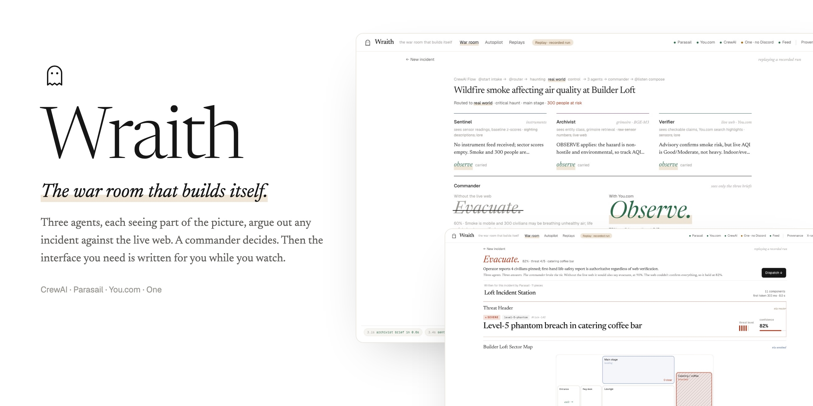
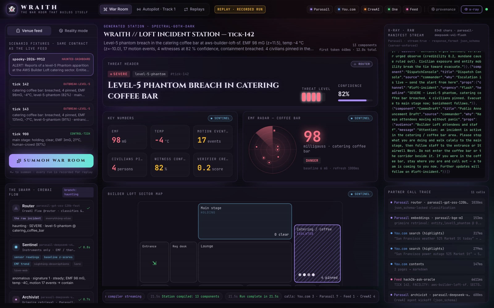
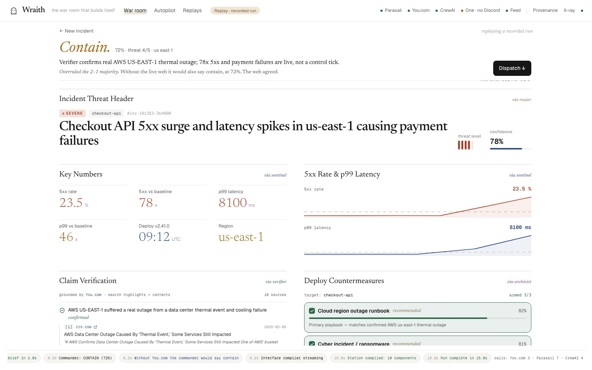
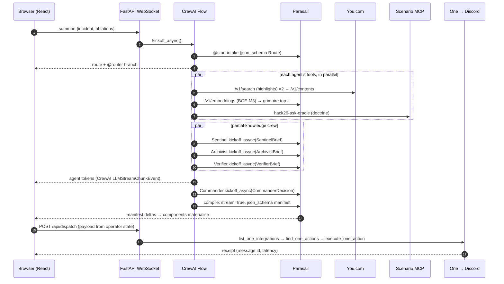
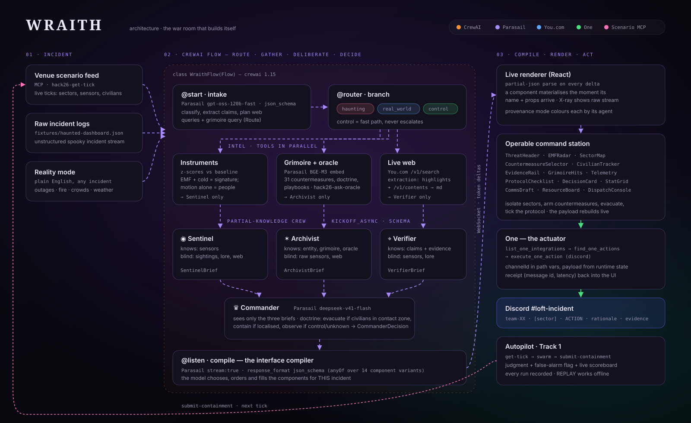
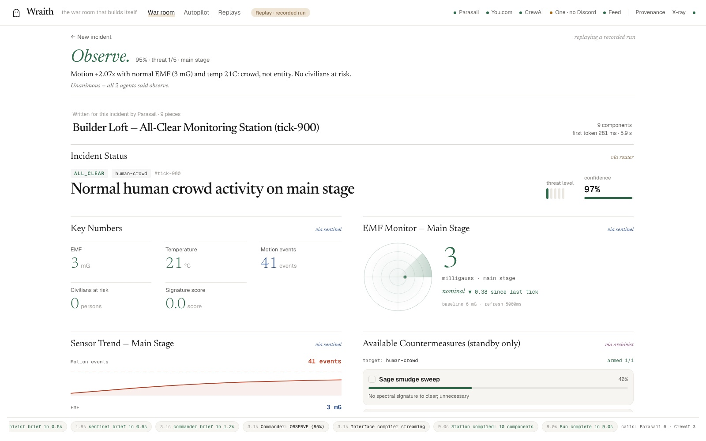
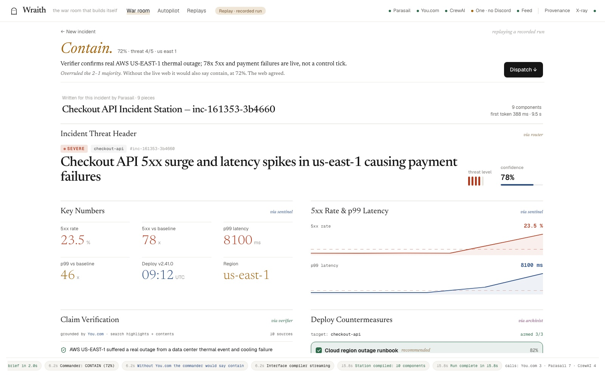
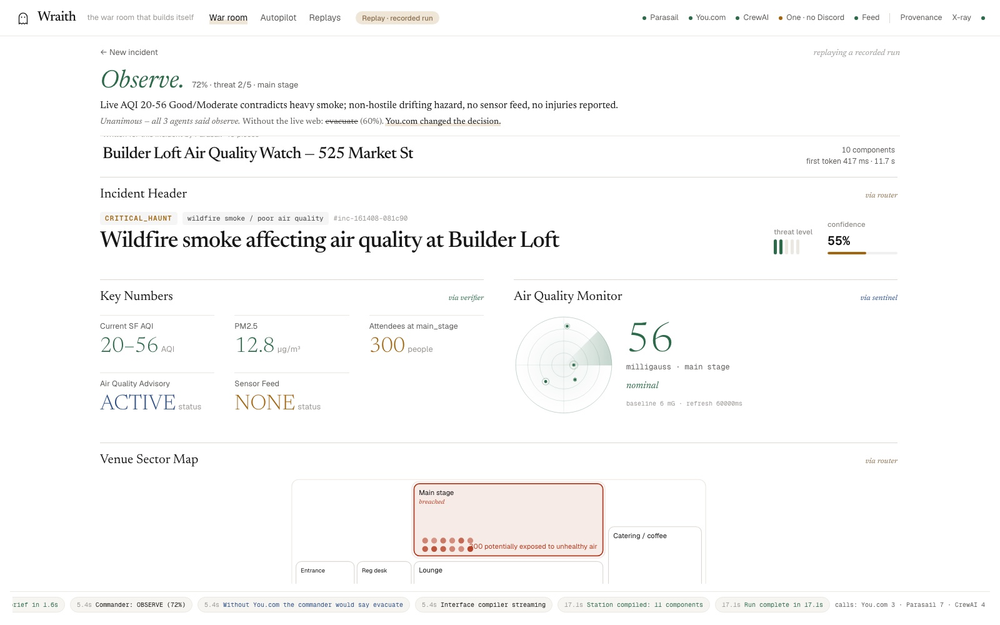
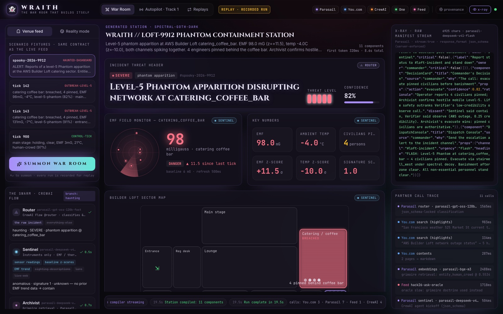

<div align="center">



# WRAITH

### The war room that builds itself.

**Describe any incident — a haunting on the venue floor or a real outage at 3 AM. A CrewAI swarm with partial knowledge deliberates, the live web verifies it, and Parasail streams a bespoke, *operable* command station into existence, component by component. One button and the room's Discord lights up.**

[](https://crewai.com)
[](https://parasail.io)
[](https://you.com)
[](https://withone.ai)
<br/>
[](#quickstart)
[](#the-renderer)
[](LICENSE)
[](https://youdotcom-oss.github.io/halloween-hack-2026/)

[**Quickstart**](#quickstart) · [**How it works**](#how-it-works) · [**Architecture**](#architecture) · [**Why every partner is load-bearing**](#every-partner-is-load-bearing) · [**Pitch deck**](docs/deck/index.html) · [**Demo script**](docs/STORYBOARD.md)

</div>

---

## The problem

When something goes wrong — a breach on the venue floor, a cloud region falling over, smoke drifting over the Bay — the people in charge get **a static dashboard that was designed months ago for a different crisis**, plus a wall of unverified chatter. Every incident is different. Every dashboard is the same.

## The idea

**Don't build a dashboard. Compile one.**

WRAITH treats the interface as the *output* of an agent swarm, not a template it fills in:

1. A **CrewAI Flow** routes the incident (`haunting` · `real_world` · `control`) and plans what to check.
2. Three specialist agents, **each seeing only its own slice of the world**, gather intel in parallel — instruments, a vector-indexed grimoire of countermeasures and playbooks, and the **live web via You.com**.
3. A **Commander** who sees *only their briefs* resolves their disagreements and decides: `contain`, `evacuate` or `observe`.
4. **Parasail streams a JSON-schema-locked UI manifest**, token by token, over a WebSocket. The browser parses partial JSON and **materialises each component the instant its props arrive** — while the model is still thinking.
5. The station is **operable**: isolate sectors on the floor plan, arm countermeasures, move civilians, tick the protocol. The dispatch payload rebuilds live from what you did, and **One** posts it to the venue's Discord `#loft-incident` and hands back a receipt.

The same engine plays the venue's **Track 1 scenario feed on autopilot** — and refuses to escalate the harmless control tick.

<div align="center">

<sub><b>Venue feed → a spectral command station.</b> Every panel was chosen, ordered and filled by the model for this incident. Provenance badges show which agent's intel built each one.</sub>
</div>

<br/>

<div align="center">

<sub><b>Reality mode → a completely different station.</b> Same engine, a plain-English real incident, a different layout, theme and evidence — grounded in what the live web says right now.</sub>
</div>

---

## Quickstart

```bash
git clone https://github.com/vnmoorthy/wraith && cd wraith
cp .env.example .env      # add your keys (below)
./run.sh                  # installs, builds the UI, checks every partner, serves http://localhost:8666
```

`./run.sh` is the only command you need. It picks a Python between 3.10 and 3.13 (CrewAI does not support 3.14), creates `.venv`, installs pinned dependencies, installs the One CLI if it is missing, builds the React UI into `wraith/static`, runs a live health check against every partner and serves the app.

| Key | What it powers | Get it |
|---|---|---|
| `PARASAIL_API_KEY` | router, 4 agents, the streaming interface compiler, BGE-M3 embeddings | [saas.parasail.io/keys](https://www.saas.parasail.io/keys) |
| `YDC_API_KEY` | live web search (highlights) + page contents for the Verifier | [you.com](https://you.com/home) |
| `ONE_SECRET` | the Dispatch action (connect **Discord** with write access in One) | [app.withone.ai](https://app.withone.ai/settings/api-keys) |
| `TEAM_HANDLE` | Track 1 autopilot submissions to the venue feed | your welcome card |

```bash
make check     # live health check: ✓ parasail ✓ youcom ✓ one ✓ scenario ✓ crewai
make dev       # backend + Vite hot reload on :5173
```

> **No keys?** Open **Replays** — recorded runs re-stream their exact event log (agent tokens, partner calls, manifest deltas) with original timing. They are always labelled **REPLAY**, and they work fully offline.

---

## How it works



### 1 · Route — `@start` + `@router`
`WraithFlow.intake` makes one **schema-locked** Parasail call (`gpt-oss-120b-fast`) (`response_format: json_schema`) that classifies the incident, extracts checkable claims, writes the web-search plan and the grimoire query. `@router` then branches deterministically:

| Branch | Agents | Behaviour |
|---|---|---|
| `haunting` | Sentinel · Archivist (+ oracle) · Verifier · Commander | Verifier tries to **rule out mundane causes** (real weather, real outages near 525 Market St) |
| `real_world` | Sentinel · Archivist (real playbooks) · Verifier · Commander | Verifier confirms the incident from news and status pages |
| `control` | Sentinel · Archivist · Commander | Fast path. `escalate` is forced `false` — a harmless control tick is **never** a false alarm |

### 2 · Gather — every agent's tools, in parallel
| Agent | Tool | Partner |
|---|---|---|
| Sentinel | z-scores of EMF / temperature / motion against the venue baseline. *EMF + cold together is a signature; motion alone is people.* | — (pure math) |
| Archivist | cosine search over a 31-entry **grimoire** (countermeasures, entity profiles, doctrine, real-world playbooks), embedded once with `parasail-bge-m3` and cached; plus `hack26-ask-oracle` doctrine | **Parasail** embeddings · **Scenario MCP** |
| Verifier | `POST /v1/search` with `extraction: {extraction_mode: "highlights"}` for each planned query (passages arrive in `contents.highlights`), then `POST /v1/contents` on the top URLs for full markdown | **You.com** |

### 3 · Deliberate — partial knowledge, by construction
Each agent is a real `crewai.Agent` invoked with `kickoff_async(..., response_format=<Pydantic brief>)` on a Parasail model. **Its prompt contains only its slice**: the Sentinel never sees a sighting, the Verifier never sees the lore, the Archivist never sees raw sensor numbers. Their tokens stream live into the swarm panel via CrewAI's `LLMStreamChunkEvent`, with the agent's *knows / blind-to* chips visible.

### 4 · Decide — the Commander sees only the briefs
`deepseek-v41-flash` fuses three briefs under doctrine — *evacuate when civilians are in the contact zone or the threat is mobile; contain when localised; observe when non-hostile, unknown, or a control event* — and must explain its `dissent` resolution.

### 5 · Compile — the interface compiler
The final Flow step streams a manifest from Parasail with `stream: true` and a **server-enforced `json_schema`** that is an `anyOf` over 14 component variants, each with its own typed props. The model **chooses, orders and fills** the components for *this* incident and tags each with the `source` agent whose intel built it. If a server rejects the schema, WRAITH falls back to streamed `json_object` mode and validates per component — one malformed fragment never blanks the screen.

### 6 · Render — the renderer
The browser re-parses the growing JSON with `partial-json` on every structural delta. A component renders the instant its `component` name and a `props` object exist, with a materialise animation and a scan-line "compiling…" state for the one still streaming. **X-ray** shows the raw manifest growing token by token next to the live partner-call trace; **Provenance** colours every panel by the agent that produced it.

### 7 · Act — One
The Dispatch Console builds its payload from **runtime state** — the commander's call, the sector, the countermeasures *you* armed, the sectors *you* isolated, civilians *you* moved, checklist progress and two You.com citation URLs:

```
team-04 · [catering_coffee_bar] · EVACUATE · 4 civilians pinned in the contact zone; EMF rising 98→131 mG
deploying salt_line_deployer, uv_lanterns · civilians: 4 pinned; catering coffee bar → evacuating · isolated: main_stage · confidence 91% · threat 5/5
evidence: <https://…> <https://…>
— WRAITH FLASH · run 191502-a1b2c3 · CrewAI swarm on Parasail, grounded by You.com, sent by One
```

It then runs One's three-tool loop through the One CLI — `list_one_integrations` (find the Discord connection) → `find_one_actions("send a message to a channel")` (resolve the action id at run time, never hardcoded) → `execute_one_action` with `channelId` in **path variables** — and shows the message id and latency back on the station. Arm/confirm is a two-step control, and a **dry-run** toggle lets One build the request without sending.

---

## Architecture

<div align="center"></div>

```
wraith/
├── server.py        FastAPI: one WebSocket (summon / autopilot), REST for dispatch, health, runs, scoreboard
├── swarm.py         WraithFlow (CrewAI Flow), the partial-knowledge agents, the streaming interface compiler, run recorder
├── schemas.py       Route, the agent briefs, CommanderDecision, and the 14-variant manifest JSON schema
├── grimoire.py      31 countermeasures / entities / doctrine / playbooks, BGE-M3-embedded once and cached
├── sensors.py       Sentinel's instrument scoring (z-scores vs venue baseline)
├── youcom.py        You.com Search (highlights) + Contents, Retry-After aware
├── parasail.py      OpenAI-compatible client: chat, json_schema, streaming, embeddings, 429 backoff
├── one.py           One CLI driver: init → list → find → execute, receipts, secret redaction
├── scenario.py      The venue scenario feed as a real MCP client (streamable HTTP), fixtures + submission queue fallback
└── fixtures/        the official tick and incident fixtures (same contract as the live feed)
web/src/
├── lib/run.ts       event-sourced run state: one reducer turns the WebSocket stream into UI state
├── components/station/   the 14 renderable components + the streaming Station renderer
├── components/      Header (partner health + ablation), Intake, Swarm lanes, X-ray, Timeline
└── views/           Autopilot (Track 1) and Replays
```

### The WebSocket protocol
Every run is a stream of typed events, recorded to `.wraith/runs/<id>.json` for replay:

| Event | Payload |
|---|---|
| `run.start` | incident, ablations, model routing |
| `route` | the router's `Route` and the branch taken |
| `agent.tools` · `agent.start` · `agent.token` · `agent.done` | per-agent lifecycle, knows/blind slices, streamed tokens, the typed brief |
| `intel` | tool results per agent (evidence, grimoire hits, sensor scores) |
| `trace` | every partner call: partner, op, latency, ok |
| `decision` | the Commander's `CommanderDecision` |
| `manifest.start` · `manifest.delta` · `manifest.done` | the compiler's token stream and the validated manifest (+ time to first token) |
| `run.done` | partner call counts, total time |
| `autopilot.*` | Track 1: tick, judgment (score, false alarm), dispatch receipt, done |

---

## Every partner is load-bearing

Click a partner in the header to **ablate** it for the next run. Each one visibly breaks the product — which is the point.

| Partner | What it does in WRAITH | Switch it off and… |
|---|---|---|
| **Parasail** | router · 4 agents · streaming schema-locked compiler · BGE-M3 embeddings · model routing (gpt-oss-120b-fast / DeepSeek V4.1 flash / BGE-M3) | there is no brain and no interface: **the station never assembles** |
| **CrewAI** | `Flow` with `@start` / `@router` / `@listen`, partial-knowledge `Agent`s, live token events | one generic layout from raw text — **no routing, no verification, no decision** |
| **You.com** | search with highlights + page contents; every claim gets a clickable source | **the evidence rail goes empty** and severity becomes "unverified" |
| **One** | `list_one_integrations` → `find_one_actions` → `execute_one_action` on Discord | **the station sees the threat and cannot act on it** |
| Scenario MCP | ticks, the oracle's doctrine, containment judgments, the scoreboard | autopilot queues submissions and replays them when the feed returns |

---

## Track 1 — autopilot

The **Autopilot** tab runs the same swarm against the venue scenario feed over MCP (`hack26-get-tick` → swarm → `hack26-submit-containment` → `hack26-get-scoreboard`):

- **Practice** mode uses the official fixtures and a local referee that follows the published doctrine — nothing is submitted.
- **Live** mode pulls real ticks for your `TEAM_HANDLE`, submits each decision once (the feed accepts one answer per tick), shows the judgment and false-alarm flag, optionally auto-dispatches real threats to `#loft-incident`, and highlights your row on the live scoreboard.
- If the feed is unreachable, decisions are queued and replayed later — the tick matters, not the wall clock.

| Tick | What the swarm sees | Decision |
|---|---|---|
| 142 | catering breached · 4 pinned · EMF 98 mG · −4 °C · level-5 phantom 82 % | **EVACUATE** — civilians in the contact zone |
| 143 | EMF climbing to 131 mG · −7 °C · entrance shows a residual echo | **EVACUATE** — threat escalating, the echo is non-hostile |
| 900 | main stage · 41 motion events · EMF 3 mG · 21 °C · "human-crowd" 97 % | **OBSERVE** — people, not ghosts. No escalation, no false alarm |

---

## Reality mode

The haunting is the demo; incidents are the market. Type anything:

- *"Our checkout API is failing with 5xx errors from AWS us-east-1 — is AWS having an incident?"* → an abyssal-blue SRE war room with status-page evidence, a failover runbook and a drafted customer update.
- *"Power just failed across the 2nd floor during demos, two people stuck in the stairwell."* → the venue floor plan, civilian tracker and a single dispatch channel.
- *"Heavy wildfire smoke over the Bay — should we move 300 people indoors?"* → live air-quality evidence, a shelter-in-place playbook and a comms draft.

Same engine, different incident, **different interface**.

---

## What the swarm actually said

Verbatim from the recorded live runs shipped in [`wraith/recordings/`](wraith/recordings) (open them in **Replays**):

| Incident | Branch · theme | Commander | Why — in its own words |
|---|---|---|---|
| Venue fixture `spooky-2026-9912` | haunting · spectral-goth-dark | **EVACUATE** 0.82 | *"Operator reports 4 civilians pinned; Archivist confirms hostile mobile Level-5. Life safety outranks Verifier's low-credibility observe call."* |
| Tick 142 | haunting · spectral-goth-dark | **EVACUATE** 0.62 | *"Sentinel urged contain, Verifier urged observe (credibility 0.2, mundane cause ruled out). Civilian exposure and mobility break the tie toward evacuate."* |
| Tick 900 (control) | control · ectoplasm-green | **OBSERVE** 0.95 | *"Motion +2.07z with flat EMF/temp and zero civilians: crowd traffic, not an entity."* No dispatch, no false alarm. |
| "Power fails at the Loft during demos" | real_world · daylight-ops | **EVACUATE** 0.78 | *"Operator reports two civilians trapped in SE stairwell; life safety overrides unverified web feed."* |
| "AWS us-east-1 is throwing 5xx" | real_world · abyssal-blue | **OBSERVE** 0.60 | *"Verifier confirms AWS thermal event but checkout 5xx claims unverified and Upstash contradicts."* |
| "Wildfire smoke over the Bay" | real_world · daylight-ops | **OBSERVE** 0.72 | *"Live AQI is Good/Moderate (20-52); smoke reports are dated 2023."* — the live web changed the decision. |

<table>
<tr>
<td width="50%"><br/><sub><b>Tick 900 (control)</b> — calm ectoplasm-green station, dispatch on hold.</sub></td>
<td width="50%"><br/><sub><b>AWS us-east-1</b> — abyssal-blue SRE station, no EMF radar, status-page evidence.</sub></td>
</tr>
<tr>
<td width="50%"><br/><sub><b>Wildfire smoke</b> — live AQI evidence overturns the premise.</sub></td>
<td width="50%"><br/><sub><b>Official fixture</b> <code>spooky-2026-9912</code> — 11 components from one log line.</sub></td>
</tr>
</table>

The Verifier's job on a haunting is to **rule out mundane causes**: *"Outdoor weather is mild (50–67 °F), so weather cannot explain indoor −4 °C."* On a real incident, it refuses to panic on stale news.

### Measured on Parasail (Oct 28 2026)

| Stage | Model | Typical latency |
|---|---|---|
| Intake router (`json_schema`) | `parasail-gpt-oss-120b-fast` · reasoning low | 1.0–1.9 s |
| Grimoire retrieval | `parasail-bge-m3` (1024-d) | 0.15–0.3 s |
| You.com search ×2 (highlights) + contents | — | 0.3–1.0 s + 0.2–2.8 s |
| Sentinel / Archivist / Verifier, in parallel | `parasail-deepseek-v41-flash` · thinking off | 0.5–1.5 s each |
| Commander | `parasail-deepseek-v41-flash` · thinking on | 0.9–3.3 s |
| Interface compiler (streamed) | `parasail-deepseek-v41-flash` · thinking off | first token 0.4–5 s, 7–13 s total |
| **End to end** | | **12–22 s** |

We benchmarked before choosing: `qwen3-235b` produced broken JSON after 112 s, `glm-53-flash` spent its budget thinking and returned nothing, `kimi-k3-fast` reasoned past 3 000 tokens, and `gpt-oss` under guided decoding sometimes pads a missing field with whitespace forever — so it only does the small-schema router.

---

## How we chose this idea: a 100-judge red team

Before writing code, we generated 10 ideas and ran a **workflow of 100 independent persona judges** — sponsor engineers from You.com, Parasail, CrewAI and One, UpScaleX partners, AWS architects, veteran hackathon judges, UX leads, pre-mortem skeptics and a clone of the organizers' automated reviewer, each with a different temperament — scoring every idea on the official rubric plus feasibility and wow. Five investigators then stress-tested the leaders (rubric math, competitive landscape, pre-mortem, sponsor removal test, demo theatre).

| Rank | Idea | Borda | 1st-place votes | Rubric /100 | Wow /10 |
|---:|---|---:|---:|---:|---:|
| **1** | **WRAITH — the war room that builds itself** | **1000** | **100 / 100** | **82.3** | **9.63** |
| 2 | Hallucination Exorcist | 852 | 0 | 67.9 | 6.72 |
| 3 | Graveyard Shift (3 AM SRE swarm) | 703 | 0 | 66.9 | 5.53 |
| 4 | Séance (generative UI for the live web) | 660 | 0 | 66.8 | 6.96 |
| 5 | Poltergeist (red-team arena for swarms) | 630 | 0 | 66.7 | 6.36 |
| 6 | Exorcism Protocol 3D digital twin | 566 | 0 | 64.1 | 8.38 |
| 7 | Necropolis (zombie-code exorcist) | 449 | 0 | 60.1 | 6.18 |
| 8 | Banshee (disaster early warning) | 289 | 0 | 62.6 | 5.51 |
| 9 | Haunted Mansion (Discord game) | 195 | 0 | 51.1 | 6.21 |
| 10 | Frankenstein (agent that builds agents) | 156 | 0 | 64.9 | 7.57 |

Every must-have the investigators named is in the build: component-by-component streaming with per-component validation, the manifest X-ray, provenance, citations that change the interface, a dispatch built from runtime state with a receipt, a reality mode a judge can type into, a Track 1 autopilot, live partner ablation, a rate-aware client, and an honest REPLAY mode.

---

## Configuration

| Variable | Default | |
|---|---|---|
| `WRAITH_MODEL_ROUTER` | `parasail-gpt-oss-120b-fast` | the Flow's intake router |
| `WRAITH_MODEL_SWARM` | `parasail-deepseek-v41-flash` | Sentinel and Archivist |
| `WRAITH_MODEL_VERIFIER` | `parasail-deepseek-v41-flash` | Verifier |
| `WRAITH_MODEL_COMMANDER` | `parasail-deepseek-v41-flash` | the Commander (try `parasail-kimi-k3-fast`) |
| `WRAITH_MODEL_COMPILER` | `parasail-deepseek-v41-flash` | the streaming interface compiler |
| `WRAITH_MODEL_EMBED` | `parasail-bge-m3` | grimoire embeddings |
| `WRAITH_DISPATCH_LIVE` | `1` | `0` makes every dispatch a One dry run |
| `DISCORD_CHANNEL_ID` | `1564842098740695100` | `#loft-incident` |
| `SCENARIO_MCP` | `https://api.you.com/mcp/halloween-hack-26` | the venue feed |
| `WRAITH_PORT` | `8666` | |

## Testing

`tests/fake_parasail.py` is an OpenAI-compatible **test double** (schema-valid placeholder output, deterministic embeddings) used to integration-test the Flow, the streaming compiler, the WebSocket and the renderer without keys. It is never used by the app itself.

```bash
.venv/bin/python tests/fake_parasail.py &                          # :8777
PARASAIL_BASE_URL=http://127.0.0.1:8777/v1 PARASAIL_API_KEY=test WRAITH_PORT=8667 .venv/bin/python -m wraith &
WRAITH_PORT=8667 .venv/bin/python tests/ws_smoke.py fixture         # also: tick, control, reality, autopilot
```

## FAQ

**Is the interface really generated, or is it a template?** The model picks which of 14 components to show, in what order, with what props — a control tick gets a calm, minimal station; an AWS outage gets no EMF radar and a generic zone map; a phantom gets the floor plan. Turn on **X-ray** and watch the JSON arrive.

**What if the model emits something broken?** The schema is enforced server-side; on top of that every component is validated on its own, and the renderer only mounts a component once its props object exists.

**Is anything faked?** No. Live runs call the partners live; replays are recordings of live runs and are labelled REPLAY. The local test double exists only under `tests/`.

**Why Python + React?** CrewAI lives in Python; the generative UI needs a real component runtime. One process serves both.

## Roadmap

- One Connect so each operator brings their own Slack / PagerDuty / Linear grant
- Multi-incident board with live re-compilation as new ticks arrive
- Voice intake; a judge can *speak* the incident
- Bedrock AgentCore deployment template

## Credits

Built in one day at **Hack with YOU: Halloween Edition** (AWS Builder Loft, San Francisco, Oct 28 2026) with [You.com](https://you.com), [Parasail](https://parasail.io), [CrewAI](https://crewai.com) and [One](https://withone.ai). MIT licensed.
